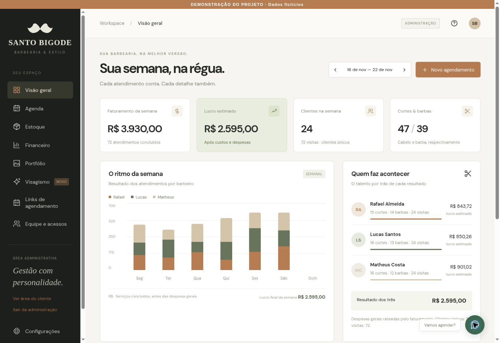
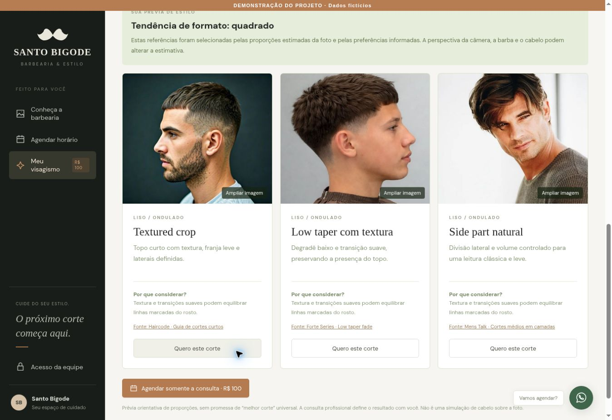

# Santo Bigode | Gestão de barbearia e visagismo com visão computacional

**Para abrir no Visual Studio Code:** leia [ABRIR_NO_VSCODE.md](ABRIR_NO_VSCODE.md). O workspace e a configuração de F5 já estão incluídos.

Protótipo funcional que conecta a experiência do cliente à administração de uma barbearia com três profissionais. Reúne agendamento, estoque, financeiro e uma prévia de estilo por foto, com processamento de imagem no próprio navegador.

**Status:** protótipo funcional v4. Sem alegação de validação comercial, precisão clínica ou resultados de negócio medidos. Os prints usam dados fictícios.



## Proposta

Uma barbearia precisa organizar sua operação e ajudar o cliente a decidir o próximo corte. O Santo Bigode reúne esses dois fluxos: o cliente explora referências, recebe sugestões orientativas e agenda; a equipe acompanha atendimentos, insumos e resultados em uma área protegida.

A proposta de valor é reduzir a fragmentação entre agenda e gestão e dar uma base visual à conversa com o barbeiro. A consulta de visagismo é um serviço adicional de **R$ 100,00 por 60 minutos**. A prévia digital é gratuita; corte e barba são cobrados à parte. Não há pagamento online implementado.

## Experiência do cliente

- Portfólio em carrossel, catálogo de serviços e referências visuais.
- Agendamento por profissional, data e horário, respeitando duração e conflitos.
- Link público da barbearia e links que já selecionam um barbeiro.
- Foto ou câmera com consentimento para a análise local.
- Duas ou três sugestões de corte com imagem, motivo e fonte.
- Escolha de referência encaminhada às observações do agendamento.
- Chatbot guiado para serviços, horários e reservas; ícone e link de WhatsApp.

## Administração

- Agenda com conclusão, cancelamento, pausas e importação da agenda antiga.
- Estoque com cadastro, mínimo, entradas, saídas e histórico de movimentações.
- Semana financeira com faturamento, custos, despesas e lucro estimado.
- Gráfico diário dos serviços por barbeiro e fechamento dos três profissionais.
- Contagem de cabelos, barbas, visitas e clientes únicos.
- Exportação CSV, backup e restauração JSON.
- Cadastro de e-mails dos profissionais, suspensão e reativação.
- Todos os profissionais autorizados acessam toda a administração; somente o responsável gerencia acessos.

## Onde está a inteligência artificial

O projeto usa **modelos pré-treinados de visão computacional para detectar pontos faciais**. A estimativa de formato e as recomendações seguintes são regras explícitas do projeto. Esta distinção permite explicar exatamente o papel da IA.

| Etapa | Implementação | Natureza |
| --- | --- | --- |
| Entrada | Foto/arquivo ou câmera, consentimento e redução para até 800 px no maior lado | Preparação local |
| Pontos faciais | MediaPipe FaceLandmarker, WebAssembly, modo IMAGE e execução CPU | Inferência com modelo pré-treinado |
| Compatibilidade | Sem WebGL2: Face-API/TensorFlow.js CPU, TinyFaceDetector + landmarks de 68 pontos | Inferência alternativa |
| Controle de entrada | Recusa ausência de rosto, mais de uma pessoa ou inclinação acima do limite | Validações |
| Proporções | Distâncias relativas de comprimento, maçãs do rosto, mandíbula e testa | Heurística geométrica |
| Tendência de formato | Oval, arredondado, quadrado, alongado ou coração | Regras por limiar |
| Referências | Formato estimado + textura declarada + preferência de estilo | Curadoria e regras |
| Ação | Seleção da imagem, observação e consulta adicional de R$ 100 | Fluxo de negócio |

### Como funciona

1. O cliente escolhe uma foto ou usa a câmera e autoriza a análise.
2. O navegador limita a resolução, carrega os modelos locais e detecta os pontos faciais.
3. O aplicativo verifica a entrada e calcula proporções. Por exemplo, a relação comprimento/largura orienta a tendência de formato; esses limiares são heurísticos.
4. O catálogo é ordenado de acordo com a estimativa, textura e preferência informadas pelo cliente.
5. As imagens ajudam a conversar sobre possibilidades. A decisão final é feita com o profissional.

**Privacidade:** o código atual não envia nem salva a foto, os landmarks ou a estimativa no servidor. O processamento acontece no dispositivo. Remover a foto ou sair da página libera o objeto da imagem e encerra a câmera. Modelos e runtimes são distribuídos no aplicativo; não há chamada a uma API externa de análise facial.

**Escopo real:** não há treinamento próprio, reconhecimento de identidade, geração de cabelo, montagem do corte sobre a foto, diagnóstico ou taxa de acerto validada. Não são inferidas idade, gênero ou emoções. O aplicativo estima proporções; não determina um “melhor corte” universal. Luz, pose, barba, acessórios e diferenças entre detectores podem alterar a sugestão.

**O chatbot é separado:** `web/chat.js` implementa estados e regras de agendamento. Não utiliza LLM e não deve ser apresentado como IA generativa. A integração WhatsApp é um link revisado pelo usuário, sem envio automático ou WhatsApp Cloud API.



## Tecnologias e arquitetura

| Camada | Tecnologia e responsabilidade |
| --- | --- |
| Interface | HTML, JavaScript em módulos e CSS responsivo; identidade visual própria |
| IA no cliente | MediaPipe Tasks Vision; Face-API/TensorFlow.js como alternativa CPU; WebAssembly |
| Execução local | Python 3.10+, biblioteca padrão, ThreadingHTTPServer e SQLite |
| Online já implementado no projeto | API TypeScript em Workers/Vinext e banco D1; frontend compartilhado |
| Sessão local | Hash PBKDF2-SHA256 com salt, cookie HttpOnly/SameSite e expiração |
| Acesso online | Identidade autenticada pelo gateway da hospedagem + lista de e-mails autorizados |
| Persistência | Validação no servidor, controle de revisão, histórico e tratamento de conflito |

Este repositório de divulgação contém a **versão local executável** e o núcleo da API online em `lib/`, com esquema SQL e testes. O adaptador completo da plataforma de hospedagem e suas configurações privadas não estão incluídos. Não é um pacote de implantação automática em qualquer provedor.

O link online funciona com o servidor hospedado, sem manter um PC ligado. A instalação Python usa outro banco: **não há sincronização automática entre local e online**. GitHub hospeda o código; GitHub Pages sozinho não executa Python, SQLite ou a API administrativa.

O módulo `lib/team-access.ts` espera identidade inserida por um gateway confiável. Esse cabeçalho não pode ser aceito diretamente de um cliente em uma implantação própria; adapte a autenticação antes de reutilizá-lo fora da plataforma original.

## Executar localmente

Requisito: Python 3.10 ou superior. Nenhum pacote Python externo é necessário.

```bash
python server.py
```

No macOS/Linux, use `python3 server.py`. No Windows, também é possível abrir `Iniciar_Windows.bat`. O aplicativo abre em `http://127.0.0.1:8765`. Mantenha o terminal aberto. A instalação escuta apenas em localhost; não é um servidor de produção público.

No primeiro acesso, use o link temporário exibido no terminal para definir usuário e senha. Não existe senha padrão. Os dados são criados em `data/` e preservados entre execuções. O material inicial é demonstrativo e pode ser removido pelas configurações.

## Estrutura principal

| Caminho | Função |
| --- | --- |
| `server.py` | Rotas Python, validação, transações e SQLite |
| `auth.py` | Primeiro acesso, credenciais, sessão e equipe local |
| `web/client.js` | Área pública, catálogo e formulário de agendamento |
| `web/app.js` | Painéis de administração |
| `web/visage.js` | Foto, câmera, inferência, proporções e interface dos resultados |
| `web/references.js` | Catálogo e regras de recomendação |
| `web/chat.js` | Chatbot de agendamento por estados |
| `web/store.js` | Estado, cálculos, duração, disponibilidade e importação |
| `web/domain.js` | Projeção pública e regras da reserva online |
| `web/team-ui.js` | Cadastro da equipe e links compartilháveis |
| `lib/barber-api.ts` | Núcleo da API hospedada e persistência D1 |
| `lib/team-access.ts` | Autorização online por identidade e e-mail |
| `drizzle/*.sql` | Migrações do banco hospedado |
| `docs/` | Prints reais e trechos de código para apresentação |

## Regras financeiras

Valores são armazenados em centavos inteiros. Apenas atendimentos concluídos entram no resultado: **receita - custos diretos - despesas gerais = lucro estimado**. No gráfico diário, o resultado dos serviços é mostrado antes das despesas gerais; o fechamento final desconta essas despesas.

O rateio entre barbeiros segue o faturamento e fecha o total em centavos. Combo corte + barba conta uma visita, um cabelo e uma barba. Clientes únicos usam telefone ou, na ausência dele, nome normalizado; isso pode agrupar homônimos. Estoque não gera venda ou lançamento automático no caixa. O resultado depende de cadastrar custos e despesas corretamente.

## Validação

```bash
python -m unittest test_server.py
node test_store.mjs
node test_access.mjs
node --experimental-strip-types test_team.mts
```

Os testes Node usam apenas módulos nativos; o teste TypeScript/D1 utiliza `node:sqlite` e requer Node moderno (22.13+). São verificadas regras de receita e rateio, conflito de horários, preços calculados no servidor, proteção de dados públicos, autenticação, cadastro/revogação de acessos e as combinações do catálogo. Essa validação funcional não mede a acurácia do visagismo.

## Imagens, autoria e publicação

As telas foram capturadas em uma cópia isolada da interface real, com registros e e-mails fictícios. O analisador de foto foi executado nessa demonstração; a imagem de entrada não integra este repositório.

As referências fotográficas vistas nos prints são externas e têm fontes indicadas na interface e em `CREDITOS.md`; não representam cortes produzidos pela Santo Bigode. Não foi comprovada uma licença para redistribuição de todas essas fotografias. Por isso, o código público inclui **placeholders SVG próprios** no lugar delas. Substitua os placeholders por fotos próprias ou autorizadas para uso público/comercial.

Licenças dos modelos, bibliotecas e fonte estão preservadas nos assets e discriminadas em `CREDITOS.md`. Nenhuma licença geral foi atribuída automaticamente ao código autoral: defina a licença que deseja conceder antes de autorizar reutilização por terceiros.

## Evolução proposta

- Avaliar a consistência das sugestões com barbeiros e usuários, medindo aceitação e qualidade.
- Calibrar os limiares e ampliar o catálogo com imagens autorizadas e diferentes texturas.
- Melhorar orientação de pose e testes de desempenho em celulares.
- Estudar permissões mais granulares, recuperação de conta e monitoramento.
- Avaliar integração de pagamentos e WhatsApp oficial quando fizer sentido ao negócio.

Esses itens são próximos passos; não são funcionalidades já concluídas.
